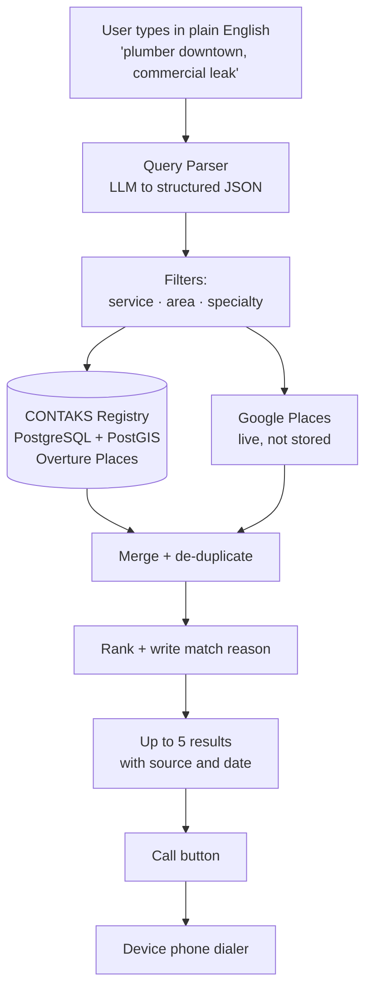
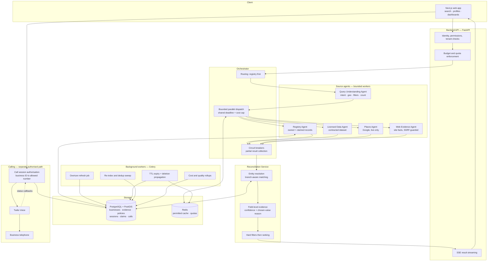

# CONTAKS — Platform Assessment & Build Plan

**Prepared by:** FlexTBS **Date:** 13 October 2026 **Status:** Assessment and proposed plan. Not a fixed-price commitment. **Based on:** CONTAKS Platform Proposal (7 Oct 2026) and CONTAKS Strategic Reassessment

---

## Contents

1. [The problem](#1-the-problem)
2. [What we are solving](#2-what-we-are-solving)
3. [Challenges and our solutions](#3-challenges-and-our-solutions)
4. [Cost — MVP and complete product](#4-cost--mvp-and-complete-product)
5. [Tools, APIs and running cost](#5-tools-apis-and-running-cost)
6. [Technology stack](#6-technology-stack)
7. [Simple MVP — features and flow](#7-simple-mvp--features-and-flow)
8. [After MVP — remaining features and full architecture](#8-after-mvp--remaining-features-and-full-architecture)
9. [Decisions we need from you](#9-decisions-we-need-from-you)
10. [References](#10-references)

---

## 1. The problem

A customer needs a plumber who handles commercial leaks, in downtown Denver, today. Right now that person has to:

- Open three or four different directory sites
- Translate their real need into whatever categories each site offers
- Read through duplicate listings with conflicting phone numbers
- Guess which business actually does the specific work they need
- Copy a phone number somewhere else to call it

**Five specific problems:**

| # | Problem | What it costs the user |
| --- | --- | --- |
| 1 | A new directory has thin coverage at launch | Searches return nothing useful |
| 2 | People describe needs in sentences; directories use categories | "Commercial leak" doesn't map to a dropdown |
| 3 | The same business appears three times with three phone numbers | No way to know which is current |
| 4 | Finding a business and contacting it are separate steps | Friction at the exact moment of intent |
| 5 | AI and API costs are unpredictable | The business model breaks at scale |

---

## 2. What we are solving

**One sentence:** a user describes what they need in their own words, gets a short list of businesses that actually match, and calls one.

| Problem | Our response |
| --- | --- |
| Thin registry | Start from an open, licensed business dataset we are allowed to store, then add claimed profiles on top |
| Natural language ≠ categories | An AI layer converts the sentence into structured filters: service, area, specialty, time |
| Duplicates and conflicts | Entity resolution at field level, with a recorded reason for every chosen value |
| Discovery and contact are separate | A Call button on every result |
| Unpredictable cost | Registry-first routing, per-search budgets, hard caps on tokens and API calls |

### What AI does and does not do

**AI does:** understand the query, expand service terminology, extract supported facts from approved sources, help rank, write a one-line match explanation.

**AI does not:** invent business names, phone numbers, addresses or opening hours. The model is not a business database. Every displayed fact traces back to a real source.

---

## 3. Challenges and our solutions

### Challenge 1 — Data rights (the critical one)

**The problem:** the original idea assumed external business data could be presented as CONTAKS's own verified database. It cannot.

We checked the terms directly:

- **Google Places** — only the place ID may be stored indefinitely. Coordinates may be cached for 30 days. All other fields may not be cached, and the terms separately prohibit using the API to build a database of addresses or places.
- **Yelp Fusion** — 24-hour cache limit, mandatory Yelp branding and attribution on any listing shown, restrictions on using the content with generative AI, and paid plans starting around USD 229 per month. Yelp also ended free API access in July 2024 with roughly four days' notice.

**Our solution — a three-layer data model:**

| Layer | Source | Stored? | Shown as |
| --- | --- | --- | --- |
| **Owned** | Overture Maps + claimed business profiles | Yes, permanently | CONTAKS data |
| **Live enrichment** | Google Places, optionally others | No | Attributed to the source |
| **Evidence** | Business websites, provider fields | Reference only | "why this matched" |

**Overture Maps** is the key. It is an open business dataset of roughly 75 million places, published monthly under CDLA-Permissive-2.0 and Apache-2.0 licences, free to download from AWS S3 and Azure. It contains no OpenStreetMap data, so it carries none of the ODbL share-alike obligations. We can store it, display it, and build on it.

This gives CONTAKS a real owned registry at zero licence cost, with Google used only to fill live gaps.

---

### Challenge 2 — Duplicate and conflicting records

**The problem:** "ABC Plumbing" appears in three sources with three phone numbers. Merging wrongly is worse than not merging — two separate branches sharing a corporate number must not become one record.

**Our solution:**

- Normalise phone numbers to E.164, canonicalise domains, standardise addresses
- Match on name + phone + address + coordinates + website together, never on one field alone
- Store every candidate value with its source, timestamp and confidence
- Pick the winning value using field-specific rules: a recently owner-confirmed phone beats an older third-party listing
- Keep the disputed values and the decision history for review
- Block the Call button when the destination confidence is too low

---

### Challenge 3 — Latency and provider outages

**The problem:** if Google is slow, the whole search must not hang. If one provider fails, valid results from others must still appear.

**Our solution:**

- Search the owned registry first — fast and always available
- Dispatch external agents in parallel under one shared deadline and cost budget
- Stream registry results immediately; merge slower results in without duplicate cards
- Circuit breakers per source: a failing provider is skipped, not retried forever
- Show honest partial status, with a capped refresh window and no infinite spinner

---

### Challenge 4 — Cost control

**The problem:** an AI call plus several API calls per search can quietly destroy unit economics.

**Our solution:**

- Registry-first routing means most searches never touch a paid API
- Hard per-search caps: maximum agents, tool calls, tokens, retries, elapsed time
- Per-tenant quotas and rate limits
- Track **cost per successful search** and **cost per connected call**, not average request cost
- Cache only what each source's licence permits

---

### Challenge 5 — Calling abuse

**The problem:** a naive "dial this number" endpoint becomes a free international dialler for attackers.

**Our solution:**

- The browser sends a **business ID**, never a phone number
- The backend resolves the allowed destination, checks freshness and location rules
- Short-lived scoped tokens per call session
- Destination allowlist, country restrictions, rate limits, call duration caps, spend caps
- Webhook signature verification; repeated callbacks handled idempotently
- Recording and transcription disabled by default

---

### Challenge 6 — Unsafe web content

**The problem:** our agents fetch pages from the open web. A malicious page could try to instruct the agent.

**Our solution:**

- Retrieved pages are treated as untrusted **data**, never instructions
- Tool allowlists, network restrictions, response size limits, strict schema validation
- SSRF protection and redirect checking on every fetch
- A fetched page cannot change agent behaviour, reveal credentials or reach internal addresses

---

### Challenge 7 — Demand and supply (not covered in the original proposal)

**The problem:** nobody has yet answered two questions.

1. Why would a user open CONTAKS instead of typing the same query into Google?
2. Why would a business claim a profile on a platform with no traffic?

**Our position:** these are not engineering problems and we cannot solve them with code. They need a go-to-market plan from the client side. We recommend the MVP be designed specifically to measure the first question cheaply, before large investment.

---

## 4. Cost — MVP and complete product

### Effort estimates

All figures are engineering hours. They exclude client-side costs, legal review and marketing.

| Scope | Description | Hours | Calendar time |
| --- | --- | --- | --- |
| **Phase 0** | Technical validation | 120 | 2–3 weeks |
| **Tier A — Proof** | Simplest working version, 1 city | 160 | 3–4 weeks, 1 dev |
| **Tier B — MVP** | Recommended MVP, 1–2 cities | 520 | 6–8 weeks, 2 devs |
| **Tier C — Complete** | Full scope from the proposal | 1,920 | 17–22 weeks, 2–3 devs |

### Tier C breakdown

| Work package | Hours |
| --- | --- |
| Phase 0 validation | 120 |
| V1 — core search platform | 520 |
| V2 — accounts, claims, admin | 320 |
| V3 — in-platform calling | 280 |
| V4 — monetisation, expansion | 360 |
| PM, QA, buffer (20%) | 320 |
| **Total** | **1,920** |

### Cost at different blended rates

Rate to be confirmed with FlexTBS commercial team.

| Blended rate | Phase 0 | Tier A Proof | Tier B MVP | Tier C Complete |
| --- | --- | --- | --- | --- |
| USD 25 / hr | $3,000 | $4,000 | $13,000 | $48,000 |
| USD 35 / hr | $4,200 | $5,600 | $18,200 | $67,200 |
| USD 50 / hr | $6,000 | $8,000 | $26,000 | $96,000 |

### Important note on the original quote

The original CONTAKS scope of **USD 18,000 over 90 working days** was priced for a **static directory MVP**. The platform described in the proposal is a different product: multi-source retrieval, entity resolution, provenance tracking, licence enforcement and telephony. Holding the original figure against this scope would set the project up to fail. We recommend re-quoting after Phase 0.

### Our recommended commercial path

1. Client approves **Phase 0 only** — small fixed fee, 2–3 weeks
2. Phase 0 produces measured coverage, relevance, latency and cost figures
3. FlexTBS issues a firm quote for Tier B based on real numbers
4. Tier C is scoped only after the MVP has real usage data

---

## 5. Tools, APIs and running cost

### Required from day one

| Service | Purpose | Lead time | Cost |
| --- | --- | --- | --- |
| **Overture Maps** | Base business registry | None — public download | **Free** |
| **Google Maps Platform** | Live enrichment, geocoding | 1 day | Pay per call |
| **OpenAI or Anthropic API** | Query understanding, extraction | Instant | Pay per token |
| **Managed PostgreSQL + PostGIS** | Primary database | 1 hour | $25–70 / mo |
| **GitHub** | Repository, CI/CD | Instant | Free–$4 / user |

### Required for the full MVP

| Service | Purpose | Cost |
| --- | --- | --- |
| **Redis** | Cache, quotas, task broker | $10–30 / mo |
| **Container hosting** | API and workers | $30–100 / mo |
| **Managed auth (OIDC)** | User accounts | Free tier → $25 / mo |
| **Sentry** | Error tracking | Free tier |
| **Email provider** | Claim verification | Free tier |
| **Domain + DNS** |  | \~$15 / year |

### Required later (Phase 2+)

| Service | Purpose | Lead time | Cost |
| --- | --- | --- | --- |
| **Twilio Voice** | In-platform calling | 2–5 days verification | \~$0.004/min browser leg, \~$0.014/min US outbound, \~$1.15/mo per number |
| **Stripe** | Subscriptions | 2–7 days verification | 2.9% + 30¢ per transaction |
| **Licensed dataset** | Deeper coverage if needed | **Unknown — needs negotiation** | Unknown |

### ⚠ Procurement items to start in week 1

These block work later if left late:

1. **Licensed dataset contract** — longest lead time, unknown duration
2. **Google Cloud billing account** — requires card and sometimes identity checks
3. **Twilio account and caller ID verification** — US voice requires identity verification
4. **Stripe business verification** — requires company documents

### Estimated monthly running cost at pilot scale

| Item | Range |
| --- | --- |
| Database, Redis, hosting | $70–200 |
| LLM tokens | $50–300 |
| Google Places calls | $100–500 |
| Monitoring, email, misc | $30–80 |
| **Subtotal** | **$250–1,080 / month** |
| Twilio (if V3 built) | Usage-based, see rates above |
| Dataset licence | Unknown until vendor confirmed |

---

## 6. Technology stack

| Layer | Choice | Why |
| --- | --- | --- |
| **Frontend** | Next.js, React, TypeScript | Responsive web, server-side rendering, streaming results |
| **Backend API** | Python, FastAPI, Pydantic | Validated contracts, async-friendly for parallel retrieval |
| **Agent layer** | Fixed-graph workflow (OpenAI Agents SDK or equivalent) | Bounded, traceable, no autonomous loops |
| **Primary database** | Managed PostgreSQL + PostGIS | Business records, provenance, geographic filtering |
| **Search matching** | Postgres full-text + trigram indexes | Start simple; add pgvector only if evaluation proves it helps |
| **Cache and quotas** | Redis | Permitted short-lived cache, rate limits, coordination |
| **Background jobs** | Celery with Redis broker | Overture refresh, expiry, imports, retries |
| **Calling** | Twilio Voice JavaScript SDK | Only if in-platform calling is selected |
| **Auth** | Managed OIDC provider | Account security without building it |
| **Payments** | Stripe | Only when a subscription model is confirmed |
| **Hosting** | Docker on managed container hosting | Separate scaling for API and workers |
| **Observability** | OpenTelemetry, Sentry, CI/CD | Trace searches, costs, failures |

### Design principles behind these choices

- **One backend to start.** Split into services only when measured load requires it.
- **Managed services over self-hosted.** Engineering time goes into the product, not infrastructure.
- **Fixed agent graph, not free-roaming agents.** Predictable cost, reproducible behaviour, auditable decisions.
- **Deterministic reconciliation.** Entity resolution uses rules, not model judgement, so results are explainable.

---

## 7. Simple MVP — features and flow

### Platform

**A responsive website. Not a mobile app.**

Users open it in a phone browser, search, tap Call, and their dialer opens. This behaves almost identically to an app, but ships in weeks instead of months, needs no app store approval, and — most importantly — requires no installation. For a product testing whether demand exists at all, asking users to install an app would invalidate the test.

A Progressive Web App (add-to-home-screen icon) can be added later in about two days. A native app only makes sense once there are proven users.

### MVP feature list

| # | Feature | Detail |
| --- | --- | --- |
| 1 | **Natural language search** | One input field, plain sentences |
| 2 | **Query parser** | LLM extracts service, location, specialty, count → validated JSON |
| 3 | **Clarification prompt** | One short question when the location is genuinely ambiguous. Never guesses silently |
| 4 | **Owned registry** | Overture Places loaded into PostgreSQL + PostGIS, one city |
| 5 | **Live Google enrichment** | Fetched at search time, attributed, never stored |
| 6 | **Entity resolution** | Merge the same business across sources; keep branches separate |
| 7 | **Results list** | Up to 5, each with name, category, distance, phone, match reason, source chip, last-checked date |
| 8 | **Business profile page** | Everything known, with source and date per field. Unknown fields shown as unknown |
| 9 | **Click-to-call** | `tel:` link opening the device dialer |
| 10 | **Honest states** | Truthful progress text, partial results, zero-result suggestions. Never pads a list |
| 11 | **Analytics** | Searches run, results clicked, call clicks, zero-result queries |

### Explicitly NOT in the MVP

User accounts · saved businesses · business claim flow · business dashboard · admin panel · Twilio browser calling · payments · reviews · bookings · quote requests · multiple cities · mobile apps · Yelp integration

### MVP flow

### What the MVP is designed to answer

1. Does natural language search beat a category dropdown in practice?
2. **Do users click Call?**
3. Where are the coverage gaps?

Three questions, three measured answers, in six to eight weeks.

### Recommendation on sequencing

**Ship the MVP, then pause building for three to four weeks and watch the data.** The temptation will be to roll straight into the next phase. We advise against it. If click-to-call volume is low, in-platform calling should not be built at all and that budget should go into coverage instead. If no business ever claims a profile, the business dashboard is wasted effort.

Building the full roadmap continuously assumes the answers are already known. They are not.

---

## 8. After MVP — remaining features and full architecture

### Version roadmap

| Version | Scope | Hours | Gate before starting |
| --- | --- | --- | --- |
| **V2** | Accounts, business claims, admin panel | 320 | MVP shows repeat usage |
| **V3** | Twilio in-platform calling | 280 | **MVP shows real call-click volume** |
| **V4** | Subscriptions, city expansion, third source | 360 | Business metrics justify investment |

### V2 — Accounts and supply side

- User sign-up and sign-in (managed OIDC)
- Saved businesses and search history
- **Business claim flow** — phone OTP or email domain verification
- Business dashboard: edit profile, hours, specialties, service area
- Correction submission from users and owners
- **Admin panel:** conflict review, duplicate candidates, claim approvals, failed searches, source policy status

### V3 — In-platform calling

- Twilio Voice JavaScript SDK integration
- Backend destination authorisation — browser sends business ID only
- Short-lived scoped session tokens
- Call session records: status, duration, charge
- Webhook signature verification with idempotent handling
- Fraud controls: destination allowlist, country limits, rate limits, duration and spend caps
- Microphone permission handling with `tel:` fallback
- Separate click / attempt / connected metrics

**Out of scope:** call recording, transcription, AI voice agents, emergency calling.

### V4 — Monetisation and expansion

- Stripe subscriptions on a confirmed pricing model
- Paid business tiers with **clearly labelled** placement
- Expansion to 4–5 cities
- Optional third data source if benchmarks justify it
- Cost dashboards: cost per successful search, cost per connected call

### Deferred to a separate product phase

Reviews · bookings · payments to businesses · request-a-quote · business chat · AI voice outreach · native mobile apps · nationwide rollout · advertising · advanced recommendation models

---

### Complete architecture — with background agents

### Key architectural rules shown above

1. **Search agents never place calls.** Calling is a separate authorised backend path. This is a security boundary, not a diagram convenience.
2. **The orchestrator has no unbounded loops.** Fixed graph, fixed deadline, fixed budget.
3. **Reconciliation is deterministic.** Rules and recorded reasons, not model judgement, so every ranking decision is auditable.
4. **Background workers respect source retention rules.** Expiry and deletion propagate across the database, cache and any search index.
5. **Restricted provider content is handled transiently.** Only data we are licensed to keep is written to PostgreSQL.

---

## 9. Decisions we need from you

Build commitment cannot be finalised until these are answered.

### Blocking — needed before Phase 0 completes

1. **Which dataset vendor?** Name, sample data, and the contract clauses covering storage, display and redistribution rights.
2. **Which pilot city?** We recommend starting with one, not four or five.
3. **Calling option:** click-to-call only for the MVP, or in-platform calling from the start?

### Needed before Tier B quote is finalised

4. Expected traffic — searches per day at pilot scale
5. Hard search filters that must always apply
6. Business claim verification method — phone OTP, email domain, or document
7. Subscription model — confirmed pricing or still tentative
8. Hosting and ongoing maintenance responsibility — FlexTBS or client-side

### Needs client-side legal review

9. US calling features touch TCPA and Do Not Call regulations. Even user-initiated calls should be reviewed by counsel before launch.
10. All data licence terms in this document should be confirmed by your legal counsel before commercial reliance. FlexTBS is not providing legal advice.

---

## Summary for the client conversation

> The technical plan in the original proposal is sound and we can build it. Its real value is that it identified, before any money was spent, that the whole project depends on a data licence nobody has reviewed.
> 
> Google and Yelp data cannot legally be stored or presented as CONTAKS's own database, at any budget. But an open dataset called Overture Maps gives us roughly 75 million business records that we **can** store, display and build on, at zero licence cost. With that one change, the product the client imagined becomes buildable.
> 
> We recommend a short paid validation phase to settle the data question with real measurements, then a firm quote for a six-to-eight-week MVP in a single city. The MVP is deliberately small because it exists to answer one question that nobody can currently answer: do users actually click Call?

---

## 10. References

Terms and documentation reviewed 13 October 2026.

- Google Maps Platform Service Specific Terms — [https://cloud.google.com/maps-platform/terms/maps-service-terms/](https://cloud.google.com/maps-platform/terms/maps-service-terms/)
- Google Places API Policies — [https://developers.google.com/maps/documentation/places/web-service/policies](https://developers.google.com/maps/documentation/places/web-service/policies)
- Yelp Fusion Display Requirements — [https://terms.yelp.com/developers/display_requirements/](https://terms.yelp.com/developers/display_requirements/)
- Overture Maps Places Guide and licensing — [https://docs.overturemaps.org/guides/places/](https://docs.overturemaps.org/guides/places/)
- Overture Maps on AWS Open Data Registry — [https://registry.opendata.aws/overture/](https://registry.opendata.aws/overture/)
- Twilio Voice JavaScript SDK — [https://www.twilio.com/docs/voice/sdks/javascript](https://www.twilio.com/docs/voice/sdks/javascript)
- Twilio Client pricing — [https://www.twilio.com/client/pricing](https://www.twilio.com/client/pricing)

**Source documents:** CONTAKS Platform Proposal (7 October 2026); CONTAKS Strategic Reassessment (client-supplied).

---

*All cost and timeline figures in this document are estimates based on the scope described. They assume the dataset licensing question resolves cleanly. If the licence terms turn out to be restrictive, add three to four weeks for redesign. Final pricing follows Phase 0 measurement.*