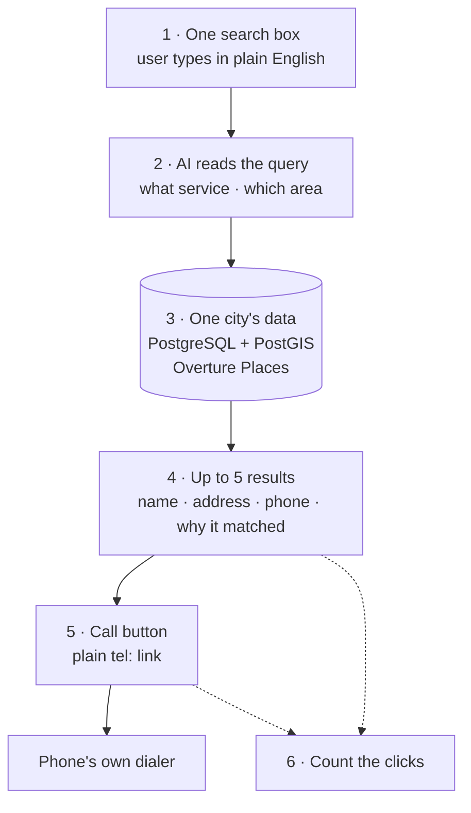
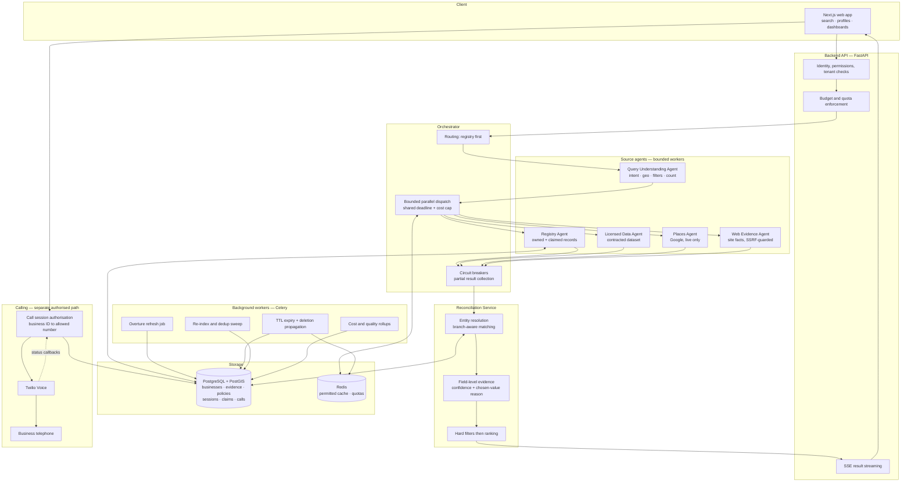

# CONTAKS — Platform Assessment & Build Plan

**Prepared by:** FlexTBS **Date:** 13 October 2026 **Status:** Assessment and proposed plan. Not a fixed-price commitment. **Based on:** CONTAKS Platform Proposal (7 Oct 2026) and CONTAKS Strategic Reassessment

---

## Contents

1. [The problem](#1-the-problem)
2. [What we are solving](#2-what-we-are-solving)
3. [Challenges and our solutions](#3-challenges-and-our-solutions)
4. [Cost — MVP and complete product](#4-cost--mvp-and-complete-product)
5. [Tools, APIs and running cost](#5-tools-apis-and-running-cost)
6. [Technology stack](#6-technology-stack)
7. [The MVP — six features](#7-the-mvp--six-features)
8. [After MVP — remaining features and full architecture](#8-after-mvp--remaining-features-and-full-architecture)
9. [Decisions we need from you](#9-decisions-we-need-from-you)
10. [References](#10-references)

---

## 1. The problem

A customer needs a plumber who handles commercial leaks, in downtown Denver, today. Right now that person has to:

- Open three or four different directory sites
- Translate their real need into whatever categories each site offers
- Read through duplicate listings with conflicting phone numbers
- Guess which business actually does the specific work they need
- Copy a phone number somewhere else to call it

**Five specific problems:**

| # | Problem | What it costs the user |
| --- | --- | --- |
| 1 | A new directory has thin coverage at launch | Searches return nothing useful |
| 2 | People describe needs in sentences; directories use categories | "Commercial leak" doesn't map to a dropdown |
| 3 | The same business appears three times with three phone numbers | No way to know which is current |
| 4 | Finding a business and contacting it are separate steps | Friction at the exact moment of intent |
| 5 | AI and API costs are unpredictable | The business model breaks at scale |

---

## 2. What we are solving

**One sentence:** a user describes what they need in their own words, gets a short list of businesses that actually match, and calls one.

| Problem | Our response |
| --- | --- |
| Thin registry | Start from an open, licensed business dataset we are allowed to store, then add claimed profiles on top |
| Natural language ≠ categories | An AI layer converts the sentence into structured filters: service, area, specialty, time |
| Duplicates and conflicts | Entity resolution at field level, with a recorded reason for every chosen value |
| Discovery and contact are separate | A Call button on every result |
| Unpredictable cost | Registry-first routing, per-search budgets, hard caps on tokens and API calls |

### What AI does and does not do

**AI does:** understand the query, expand service terminology, extract supported facts from approved sources, help rank, write a one-line match explanation.

**AI does not:** invent business names, phone numbers, addresses or opening hours. The model is not a business database. Every displayed fact traces back to a real source.

---

## 3. Challenges and our solutions

### Challenge 1 — Data rights (the critical one)

**The problem:** the original idea assumed external business data could be presented as CONTAKS's own verified database. It cannot.

We checked the terms directly:

- **Google Places** — only the place ID may be stored indefinitely. Coordinates may be cached for 30 days. All other fields may not be cached, and the terms separately prohibit using the API to build a database of addresses or places.
- **Yelp Fusion** — 24-hour cache limit, mandatory Yelp branding and attribution on any listing shown, restrictions on using the content with generative AI, and paid plans starting around USD 229 per month. Yelp also ended free API access in July 2024 with roughly four days' notice.

**Our solution — a three-layer data model:**

| Layer | Source | Stored? | Shown as |
| --- | --- | --- | --- |
| **Owned** | Overture Maps + claimed business profiles | Yes, permanently | CONTAKS data |
| **Live enrichment** | Google Places, optionally others | No | Attributed to the source |
| **Evidence** | Business websites, provider fields | Reference only | "why this matched" |

**Overture Maps** is the key. It is an open business dataset of roughly 75 million places, published monthly under CDLA-Permissive-2.0 and Apache-2.0 licences, free to download from AWS S3 and Azure. It contains no OpenStreetMap data, so it carries none of the ODbL share-alike obligations. We can store it, display it, and build on it.

This gives CONTAKS a real owned registry at zero licence cost, with Google used only to fill live gaps.

> **Note on the MVP:** the MVP described in Section 7 uses **Overture only**. No Google, no Yelp, no licensed vendor. This means the MVP carries **no licensing risk and no contract negotiation**, and can begin immediately.

---

### Challenge 2 — Duplicate and conflicting records

**The problem:** "ABC Plumbing" appears in three sources with three phone numbers. Merging wrongly is worse than not merging — two separate branches sharing a corporate number must not become one record.

**Our solution:**

- Normalise phone numbers to E.164, canonicalise domains, standardise addresses
- Match on name + phone + address + coordinates + website together, never on one field alone
- Store every candidate value with its source, timestamp and confidence
- Pick the winning value using field-specific rules: a recently owner-confirmed phone beats an older third-party listing
- Keep the disputed values and the decision history for review
- Block the Call button when the destination confidence is too low

*This applies from V2 onward. The MVP uses a single source, so there is nothing to reconcile yet.*

---

### Challenge 3 — Latency and provider outages

**The problem:** if an external provider is slow, the whole search must not hang. If one provider fails, valid results from others must still appear.

**Our solution:**

- Search the owned registry first — fast and always available
- Dispatch external agents in parallel under one shared deadline and cost budget
- Stream registry results immediately; merge slower results in without duplicate cards
- Circuit breakers per source: a failing provider is skipped, not retried forever
- Show honest partial status, with a capped refresh window and no infinite spinner

*The MVP queries only its own database, so it has no external latency risk at all.*

---

### Challenge 4 — Cost control

**The problem:** an AI call plus several API calls per search can quietly destroy unit economics.

**Our solution:**

- Registry-first routing means most searches never touch a paid API
- Hard per-search caps: maximum agents, tool calls, tokens, retries, elapsed time
- Per-tenant quotas and rate limits
- Track **cost per successful search** and **cost per connected call**, not average request cost
- Cache only what each source's licence permits

*In the MVP the only variable cost is one LLM call per search, which is both small and capped.*

---

### Challenge 5 — Calling abuse

**The problem:** a naive "dial this number" endpoint becomes a free international dialler for attackers.

**Our solution:**

- The browser sends a **business ID**, never a phone number
- The backend resolves the allowed destination, checks freshness and location rules
- Short-lived scoped tokens per call session
- Destination allowlist, country restrictions, rate limits, call duration caps, spend caps
- Webhook signature verification; repeated callbacks handled idempotently
- Recording and transcription disabled by default

*The MVP uses a plain `tel:` link, which carries none of this risk because no call passes through our servers.*

---

### Challenge 6 — Unsafe web content

**The problem:** our agents fetch pages from the open web. A malicious page could try to instruct the agent.

**Our solution:**

- Retrieved pages are treated as untrusted **data**, never instructions
- Tool allowlists, network restrictions, response size limits, strict schema validation
- SSRF protection and redirect checking on every fetch
- A fetched page cannot change agent behaviour, reveal credentials or reach internal addresses

*The MVP does not fetch web pages.*

---

### Challenge 7 — Demand and supply (not covered in the original proposal)

**The problem:** nobody has yet answered two questions.

1. Why would a user open CONTAKS instead of typing the same query into Google?
2. Why would a business claim a profile on a platform with no traffic?

**Our position:** these are not engineering problems and we cannot solve them with code. They need a go-to-market plan from the client side. The MVP in Section 7 is deliberately designed to measure the first question as cheaply as possible, before any large investment.

---

## 4. Cost — MVP and complete product

### Effort estimates

All figures are engineering hours. They exclude client-side costs, legal review and marketing.

| Stage | Description | Hours | Calendar time |
| --- | --- | --- | --- |
| **MVP** | The six features in Section 7, one city | **160** | **3–4 weeks, 1 developer** |
| **V2** | Multi-source search and trust layer | 360 | 5–6 weeks, 2 developers |
| **V3** | Accounts, business claims, admin panel | 320 | 4–5 weeks, 2 developers |
| **V4** | In-platform calling (Twilio) | 280 | 3–4 weeks, 2 developers |
| **V5** | Subscriptions, city expansion | 360 | 4–5 weeks, 2 developers |
| **PM, QA, buffer** | 20% across all stages | 300 | — |
| **Complete product** | All of the above | **1,780** | **20–24 weeks** |

### Cost at different blended rates

Rate to be confirmed with FlexTBS commercial team.

| Blended rate | MVP (160 hrs) | Through V2 (520 hrs) | Complete (1,780 hrs) |
| --- | --- | --- | --- |
| USD 25 / hr | **$4,000** | $13,000 | $44,500 |
| USD 35 / hr | **$5,600** | $18,200 | $62,300 |
| USD 50 / hr | **$8,000** | $26,000 | $89,000 |

### Important note on the original quote

The original CONTAKS scope of **USD 18,000 over 90 working days** was priced for a **static directory MVP**. The complete platform described in the proposal is a different product: multi-source retrieval, entity resolution, provenance tracking, licence enforcement and telephony. Holding the original figure against the full scope would set the project up to fail.

Note also the reverse: the MVP we recommend is **smaller and cheaper** than the original quote, because it deliberately strips everything that is not needed to answer the one open question.

### Our recommended commercial path

1. Client approves the **MVP only** — a small fixed fee, 3–4 weeks
2. The MVP ships to a single city and runs for 3–4 weeks collecting real usage data
3. FlexTBS issues a firm quote for V2 based on what that data shows
4. Later versions are scoped only after the previous one has proven its value

---

## 5. Tools, APIs and running cost

### Required for the MVP — four items, zero contracts

| Service | Purpose | Lead time | Cost |
| --- | --- | --- | --- |
| **Overture Maps** | The business data itself | None — public download | **Free** |
| **OpenAI or Anthropic API** | Reading the user's query | Instant | \~$20 / mo at pilot volume |
| **Managed PostgreSQL + PostGIS** | Storing the city's data | 1 hour | \~$25 / mo |
| **Container hosting** | Running the site | 1 hour | \~$20 / mo |

**MVP running cost: roughly USD 65–150 per month.**

This is the single most important operational point in this document: the MVP needs **no vendor contract, no API approval, no identity verification and no legal negotiation**. Work can begin the day it is approved.

### Required later (V2 onward)

| Service | Purpose | Lead time | Cost |
| --- | --- | --- | --- |
| **Google Maps Platform** | Live enrichment, geocoding | 1 day | Pay per call, \~$100–500 / mo |
| **Redis** | Cache, quotas, task broker | Instant | $10–30 / mo |
| **Managed auth (OIDC)** | User accounts | Instant | Free tier → $25 / mo |
| **Sentry** | Error tracking | Instant | Free tier |
| **Email provider** | Claim verification | Instant | Free tier |
| **Twilio Voice** | In-platform calling | 2–5 days verification | \~$0.004/min browser leg, \~$0.014/min US outbound, \~$1.15/mo per number |
| **Stripe** | Subscriptions | 2–7 days verification | 2.9% + 30¢ per transaction |
| **Licensed dataset** | Deeper coverage if needed | **Unknown — needs negotiation** | Unknown |

### ⚠ Procurement items — start these when V2 is approved, not before

These block work if left late, but **none of them block the MVP**:

1. **Licensed dataset contract** — longest lead time, unknown duration
2. **Google Cloud billing account** — requires card and sometimes identity checks
3. **Twilio account and caller ID verification** — US voice requires identity verification
4. **Stripe business verification** — requires company documents

### Running cost by stage

| Stage | Monthly cost |
| --- | --- |
| **MVP** | **$65–150** |
| V2 (adds Google, Redis, auth) | $250–700 |
| V4+ (adds Twilio, Stripe) | $400–1,100 + usage |

---

## 6. Technology stack

| Layer | Choice | Used from |
| --- | --- | --- |
| **Frontend** | Next.js, React, TypeScript | MVP |
| **Backend API** | Python, FastAPI, Pydantic | MVP |
| **Primary database** | Managed PostgreSQL + PostGIS | MVP |
| **Search matching** | Postgres full-text + trigram indexes | MVP |
| **LLM** | OpenAI or Anthropic API, single call per search | MVP |
| **Hosting** | Docker on managed container hosting | MVP |
| **Agent layer** | Fixed-graph workflow (OpenAI Agents SDK or equivalent) | V2 |
| **Cache and quotas** | Redis | V2 |
| **Background jobs** | Celery with Redis broker | V2 |
| **Observability** | OpenTelemetry, Sentry, CI/CD | V2 |
| **Auth** | Managed OIDC provider | V3 |
| **Calling** | Twilio Voice JavaScript SDK | V4 |
| **Payments** | Stripe | V5 |

### Design principles behind these choices

- **One backend to start.** Split into services only when measured load requires it.
- **Managed services over self-hosted.** Engineering time goes into the product, not infrastructure.
- **Fixed agent graph, not free-roaming agents.** Predictable cost, reproducible behaviour, auditable decisions.
- **Deterministic reconciliation.** Entity resolution uses rules, not model judgement, so results are explainable.
- **Start simple.** Postgres full-text search first. Add vector search only if measurement proves it helps.

---

## 7. The MVP — six features

### Platform

**A responsive website. Not a mobile app.**

Users open it in a phone browser, search, tap Call, and their dialer opens. This behaves almost identically to an app, but ships in weeks instead of months, needs no app store approval, and — most importantly — requires no installation. For a product testing whether demand exists at all, asking users to install an app would invalidate the test.

A Progressive Web App (add-to-home-screen icon) can be added later in about two days. A native app only makes sense once there are proven users.

### The six features

| # | Feature | What it means |
| --- | --- | --- |
| **1** | **One search box** | The user types what they need in plain English. One field, nothing else. |
| **2** | **AI reads the query** | A single LLM call pulls out two things: **what service**, and **which area**. |
| **3** | **One city's data in our database** | Overture Places for a single city, loaded into PostgreSQL + PostGIS. Free, downloadable, legally ours to store and display. |
| **4** | **Up to 5 results** | Each showing name, address, phone, and why it matched. Never more than five. |
| **5** | **Call button** | A plain `tel:` link that opens the phone's own dialer. No telephony infrastructure. |
| **6** | **Count the clicks** | How many searches were run, and how many Call buttons were pressed. |

### Everything else is out

No user accounts · no login · no saved businesses · no business claim flow · no business dashboard · no admin panel · no Twilio · no payments · no reviews · no bookings · no second city · no Google · no Yelp · no licensed dataset · no mobile app

### MVP flow

### Why this is the right MVP

|  |  |
| --- | --- |
| **Build time** | 3–4 weeks, one developer |
| **Running cost** | \~$65–150 / month |
| **Contracts required** | **None** |
| **API approvals required** | **None** |
| **Legal risk** | **None** — Overture is openly licensed for storage and display |
| **Can start** | Immediately on approval |

### What the MVP is designed to answer

1. Does natural language search actually beat a category dropdown in practice?
2. **Do users click Call?**
3. Where are the coverage gaps in a single city?

Three questions, three measured answers, in three to four weeks.

### Recommendation on sequencing

**Ship the MVP, then pause building for three to four weeks and watch the data.** The temptation will be to roll straight into V2. We advise against it.

- If click-to-call volume is low, in-platform calling (V4) should not be built at all, and that budget should go into coverage instead.
- If no business ever claims a profile, the business dashboard (V3) is wasted effort.
- If users keep searching outside the pilot city, expansion matters more than features.

Building the full roadmap continuously assumes the answers are already known. They are not.

---

## 8. After MVP — remaining features and full architecture

### Version roadmap

| Version | Scope | Hours | Gate before starting |
| --- | --- | --- | --- |
| **V2** | Multi-source search and trust layer | 360 | MVP shows users search more than once |
| **V3** | Accounts, business claims, admin panel | 320 | V2 shows repeat usage and coverage demand |
| **V4** | Twilio in-platform calling | 280 | **MVP/V2 show real call-click volume** |
| **V5** | Subscriptions, city expansion | 360 | Business metrics justify investment |

---

### V2 — Multi-source search and trust layer

This is where everything deliberately cut from the MVP comes back.

- **Google Places live enrichment** — fetched at search time, attributed, never stored
- **Orchestrator** — parallel source dispatch under a shared deadline and cost budget
- **Entity resolution** — merge the same business across sources, keep branches separate
- **Field-level evidence** — source, timestamp and confidence stored per field
- **Business profile page** — everything known, with source and date per field; unknown fields shown as unknown
- **Clarification prompt** — one short question when the location is genuinely ambiguous
- **Honest states** — truthful progress text, "only 3 matched" instead of padding, useful zero-result suggestions
- **Source attribution UI** — per-card chips and licence-compliant display
- **Circuit breakers and partial results** — one slow provider never stalls the search
- **Background refresh jobs** — Overture updates, TTL expiry, deletion propagation
- **Second city**

### V3 — Accounts and supply side

- User sign-up and sign-in (managed OIDC)
- Saved businesses and search history
- **Business claim flow** — phone OTP or email domain verification
- Business dashboard: edit profile, hours, specialties, service area
- Correction submission from users and owners
- **Admin panel:** conflict review, duplicate candidates, claim approvals, failed searches, source policy status

### V4 — In-platform calling

- Twilio Voice JavaScript SDK integration
- Backend destination authorisation — browser sends business ID only
- Short-lived scoped session tokens
- Call session records: status, duration, charge
- Webhook signature verification with idempotent handling
- Fraud controls: destination allowlist, country limits, rate limits, duration and spend caps
- Microphone permission handling with `tel:` fallback
- Separate click / attempt / connected metrics

**Out of scope:** call recording, transcription, AI voice agents, emergency calling.

### V5 — Monetisation and expansion

- Stripe subscriptions on a confirmed pricing model
- Paid business tiers with **clearly labelled** placement
- Expansion to 4–5 cities
- Optional licensed dataset if benchmarks justify the cost
- Cost dashboards: cost per successful search, cost per connected call

### Deferred to a separate product phase

Reviews · bookings · payments to businesses · request-a-quote · business chat · AI voice outreach · native mobile apps · nationwide rollout · advertising · advanced recommendation models

---

### Complete architecture — with background agents

This is the full platform at V4/V5. The MVP is the small shaded path through the middle: search box, one LLM call, one database, five results, a `tel:` link.

### How the MVP maps onto this diagram

| Full architecture component | In the MVP? |
| --- | --- |
| Web app | ✅ Yes, simplified |
| Query Understanding Agent | ✅ Yes — one LLM call |
| Registry Agent + PostgreSQL | ✅ Yes |
| Call path | ✅ Replaced by a plain `tel:` link |
| Orchestrator, parallel dispatch, circuit breakers | ❌ V2 |
| Places / Licensed Data / Web Evidence agents | ❌ V2 |
| Reconciliation service | ❌ V2 |
| Redis, background workers | ❌ V2 |
| Auth, budgets, admin | ❌ V3 |
| Twilio call authorisation | ❌ V4 |

### Key architectural rules shown above

1. **Search agents never place calls.** Calling is a separate authorised backend path. This is a security boundary, not a diagram convenience.
2. **The orchestrator has no unbounded loops.** Fixed graph, fixed deadline, fixed budget.
3. **Reconciliation is deterministic.** Rules and recorded reasons, not model judgement, so every ranking decision is auditable.
4. **Background workers respect source retention rules.** Expiry and deletion propagate across the database, cache and any search index.
5. **Restricted provider content is handled transiently.** Only data we are licensed to keep is written to PostgreSQL.

---

## 9. Decisions we need from you

### Needed to start the MVP — only two

1. **Which city?** One city only. We suggest the one with the strongest expected early demand.
2. **Which service categories?** Either all of them, or a focused set such as home-repair trades.

Nothing else blocks the MVP. No vendor, no contract, no API approval.

### Needed before V2 is quoted

3. **Which dataset vendor, if any?** Name, sample data, and the contract clauses covering storage, display and redistribution rights. *Only needed if Overture coverage proves insufficient in measurement.*
4. Expected traffic — searches per day at pilot scale
5. Hard search filters that must always apply
6. Second city for expansion

### Needed before V3 and V4

7. Business claim verification method — phone OTP, email domain, or document
8. Calling option — confirm whether in-platform calling is still wanted after seeing MVP click data
9. Subscription model — confirmed pricing or still tentative
10. Hosting and ongoing maintenance responsibility — FlexTBS or client-side

### Needs client-side legal review

- US calling features touch TCPA and Do Not Call regulations. Even user-initiated calls should be reviewed by counsel before V4 launch.
- All data licence terms in this document should be confirmed by your legal counsel before commercial reliance. FlexTBS is not providing legal advice.

---

## Summary for the client conversation

> The technical plan in the original proposal is sound and we can build it. Its real value is that it identified, before any money was spent, that the full platform depends on a data licence nobody has reviewed.
> 
> Google and Yelp data cannot legally be stored or presented as CONTAKS's own database, at any budget. But an open dataset called Overture Maps gives us roughly 75 million business records that we **can** store, display and build on, at zero licence cost.
> 
> So we propose starting with a deliberately small MVP: one search box, one AI call to read the query, one city of Overture data, five results, a Call button, and click counting. Six features. Three to four weeks. One developer. Around $65–150 a month to run. **No contracts, no API approvals, no legal risk — work can start immediately.**
> 
> That MVP exists to answer one question that nobody can currently answer: **do users actually click Call?** Everything else in the roadmap should be decided by that answer, not before it.

---

## 10. References

Terms and documentation reviewed 13 October 2026.

- Google Maps Platform Service Specific Terms — [https://cloud.google.com/maps-platform/terms/maps-service-terms/](https://cloud.google.com/maps-platform/terms/maps-service-terms/)
- Google Places API Policies — [https://developers.google.com/maps/documentation/places/web-service/policies](https://developers.google.com/maps/documentation/places/web-service/policies)
- Yelp Fusion Display Requirements — [https://terms.yelp.com/developers/display_requirements/](https://terms.yelp.com/developers/display_requirements/)
- Overture Maps Places Guide and licensing — [https://docs.overturemaps.org/guides/places/](https://docs.overturemaps.org/guides/places/)
- Overture Maps on AWS Open Data Registry — [https://registry.opendata.aws/overture/](https://registry.opendata.aws/overture/)
- Twilio Voice JavaScript SDK — [https://www.twilio.com/docs/voice/sdks/javascript](https://www.twilio.com/docs/voice/sdks/javascript)
- Twilio Client pricing — [https://www.twilio.com/client/pricing](https://www.twilio.com/client/pricing)

**Source documents:** CONTAKS Platform Proposal (7 October 2026); CONTAKS Strategic Reassessment (client-supplied).

---

*All cost and timeline figures in this document are estimates based on the scope described. The MVP estimate assumes Overture Maps only and carries no licensing dependency. Figures for V2 and later assume the dataset licensing question resolves cleanly; if licence terms turn out to be restrictive, add three to four weeks for redesign. Final pricing for each stage follows the measurement from the previous one.*